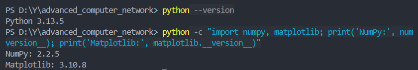
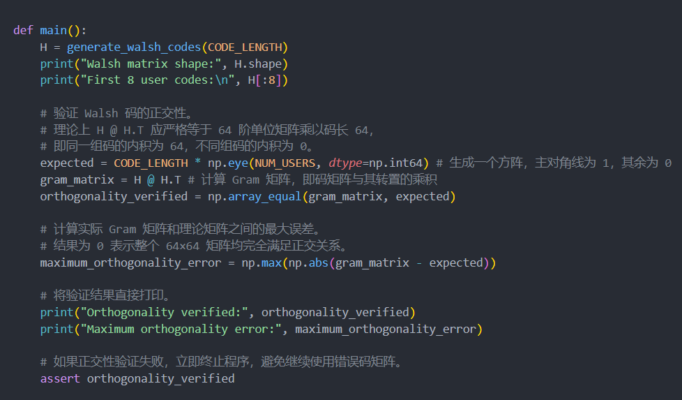
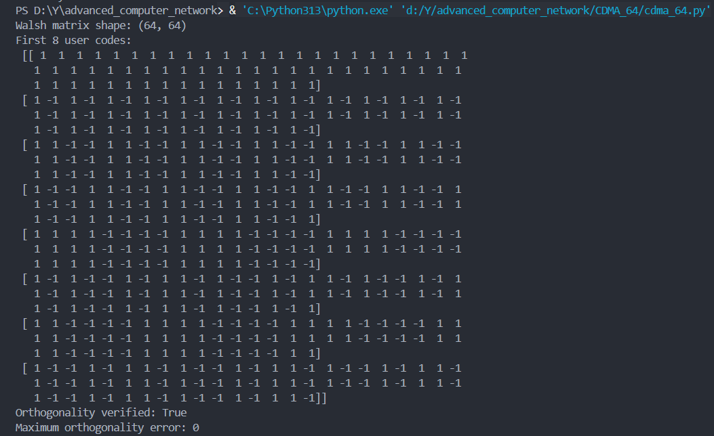
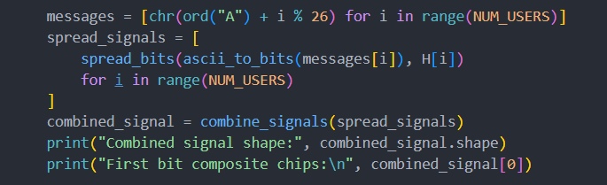
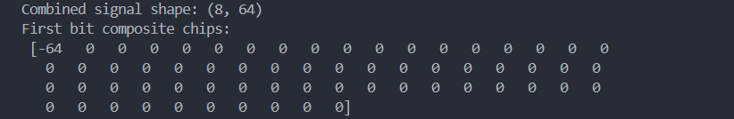
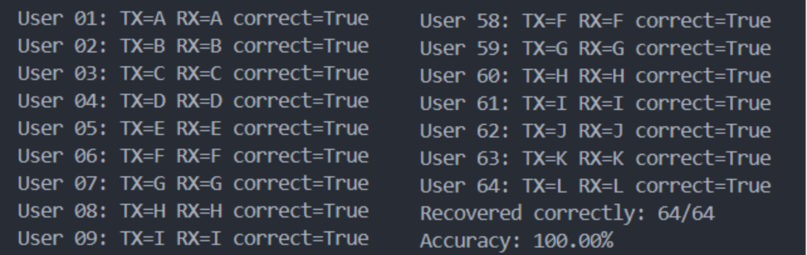
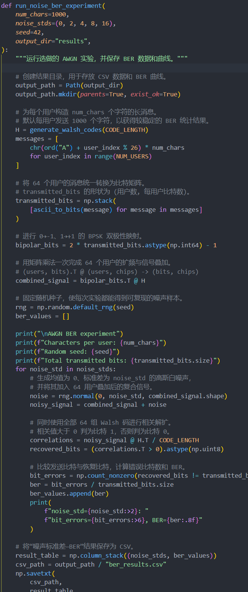
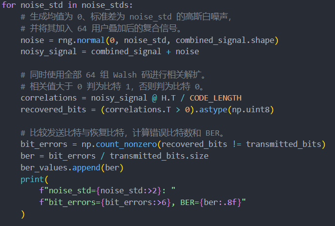
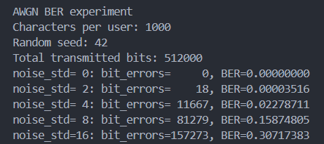
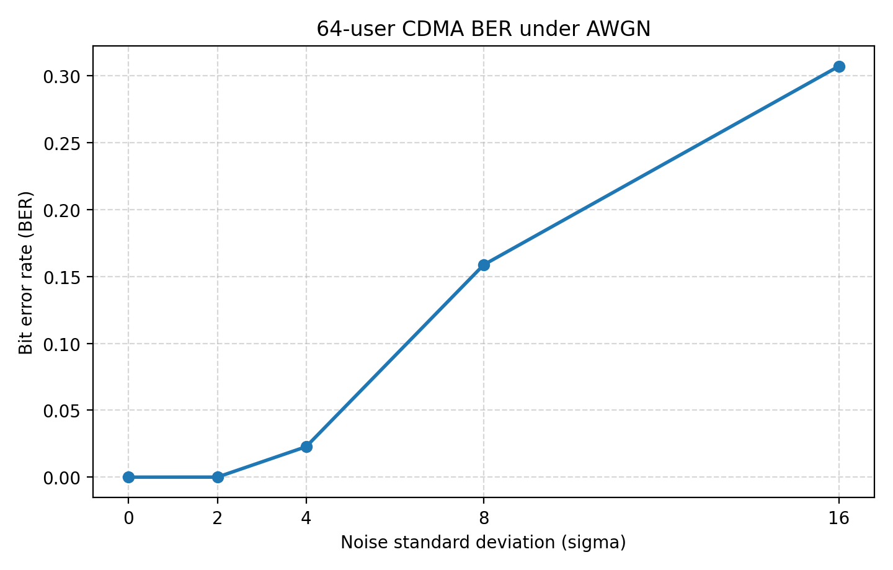

# 64 用户 CDMA 正交码生成、信号合并与解扩仿真

《高级计算机网络与分布式计算》第一次编程实验。实验利用 Walsh–Hadamard 矩阵生成 64 组正交码，完成 ASCII 编码、BPSK 双极性映射、64 用户扩频叠加、相关解扩与字符恢复，并进一步测试加性高斯白噪声（AWGN）条件下的误码率（BER）。


## 目录

- [64 用户 CDMA 正交码生成、信号合并与解扩仿真](#64-用户-cdma-正交码生成信号合并与解扩仿真)
  - [目录](#目录)
  - [主要文件：](#主要文件)
  - [实验目的](#实验目的)
  - [运行环境](#运行环境)
  - [实验原理与实现](#实验原理与实现)
    - [1. Walsh–Hadamard 正交码](#1-walshhadamard-正交码)
    - [2. 正交性验证](#2-正交性验证)
    - [3. ASCII 编码与双极性映射](#3-ascii-编码与双极性映射)
    - [4. 扩频与信号叠加](#4-扩频与信号叠加)
    - [5. 相关解扩与恢复](#5-相关解扩与恢复)
  - [基础实验结果](#基础实验结果)
  - [AWGN 噪声与 BER 实验](#awgn-噪声与-ber-实验)
    - [1. 实验模型](#1-实验模型)
    - [2. 实验流程与参数](#2-实验流程与参数)
    - [3. 关键实现](#3-关键实现)
    - [4. 噪声参数的物理含义](#4-噪声参数的物理含义)
    - [5. BER 实验结果](#5-ber-实验结果)
  - [思考题分析](#思考题分析)
    - [1. 64 组代码为什么可以同时在同一信道传输？](#1-64-组代码为什么可以同时在同一信道传输)
    - [2. 为什么采用双极性映射？](#2-为什么采用双极性映射)
    - [3. 两个用户使用同一组代码能否分别恢复？](#3-两个用户使用同一组代码能否分别恢复)
    - [4. 用户码片不同步时能否保持正交性？](#4-用户码片不同步时能否保持正交性)
    - [5. 噪声条件下 BER 受到哪些因素影响？](#5-噪声条件下-ber-受到哪些因素影响)
  - [实验总结](#实验总结)


## 主要文件：

- [`cdma_64.py`](./cdma_64.py)：完整 Python 实现。
- [`cdma_64.ipynb`](./cdma_64.ipynb)：包含已保存输出的 Jupyter Notebook。
- [`陆睿_第一次实验报告__CDMA_64.pdf`](./陆睿_第一次实验报告__CDMA_64.pdf)：按照课程模板填写并导出的实验报告。
- [`CDMA_64用户实验指导书.pdf`](./CDMA_64用户实验指导书.pdf)：实验指导书。
- [`results/ber_results.csv`](./results/ber_results.csv)：AWGN 实验的 BER 数据。

## 实验目的

1. 理解码分多址（CDMA）的码片、扩频、码正交和多址接入原理。
2. 编程构建 64×64 Walsh–Hadamard 正交码矩阵并验证正交性。
3. 将 ASCII 字符转换成 8 位二进制序列，采用 BPSK 双极性映射和正交扩频。
4. 模拟 64 台设备共用同一个物理信道发送数据，并完成信号叠加。
5. 使用相关检测方法分离用户并恢复 ASCII 字符，统计恢复正确率。
6. 分析代码复用、同步偏差和加性噪声对实验结果的影响。

## 运行环境

- Windows
- Python 3.13.5
- NumPy 2.2.5
- Matplotlib 3.10.8



安装依赖：

```bash
pip install numpy matplotlib
```

运行基础实验：

```bash
python cdma_64.py
```

运行 AWGN–BER 选做实验：

```bash
python cdma_64.py --with-noise
```

## 实验原理与实现

### 1. Walsh–Hadamard 正交码

从一阶矩阵开始递归构造：

```text
H₁ = [1]

        [ H_N   H_N ]
H_2N =  [ H_N  -H_N ]
```

递归扩展至 64×64 矩阵 H₆₄，矩阵元素取值为 `-1` 或 `+1`，第 i 行分配给第 i 个用户。

```python
def generate_walsh_codes(n=64):
    if n < 1 or (n & (n - 1)) != 0:
        raise ValueError("n must be a positive power of two")

    H = np.array([[1]], dtype=np.int64)
    while H.shape[0] < n:
        H = np.block([[H, H], [H, -H]])
    return H
```

### 2. 正交性验证

Walsh 矩阵应满足：

```text
H₆₄ × H₆₄ᵀ = 64I₆₄
```

同一组代码与自身的内积为 64，不同代码之间的内积为 0。

```python
expected = CODE_LENGTH * np.eye(
    NUM_USERS, dtype=np.int64
)
gram_matrix = H @ H.T

orthogonality_verified = np.array_equal(
    gram_matrix, expected
)
maximum_orthogonality_error = np.max(
    np.abs(gram_matrix - expected)
)

print("Orthogonality verified:", orthogonality_verified)
print("Maximum orthogonality error:", maximum_orthogonality_error)
assert orthogonality_verified
```





验证结果：

```text
Walsh matrix shape: (64, 64)
Orthogonality verified: True
Maximum orthogonality error: 0
```

结果表明，程序成功生成了 64×64 Walsh 矩阵，且 64 组代码两两正交。

### 3. ASCII 编码与双极性映射

64 个用户依次发送 A～Z，超出 26 个用户后重新循环。每个 ASCII 字符转换为 8 位二进制序列：

```python
def ascii_to_bits(text):
    raw = text.encode("ascii")
    return np.unpackbits(
        np.frombuffer(raw, dtype=np.uint8)
    )
```

原始比特 `x ∈ {0,1}` 按下式映射为双极性符号：

```text
b = 2x - 1
```

- 比特 0 映射为 `-1`；
- 比特 1 映射为 `+1`。

### 4. 扩频与信号叠加

第 i 个用户的双极性符号乘以其 Walsh 码：

```text
Sᵢ(t) = bᵢ(t)Cᵢ
```

```python
def spread_bits(bits, code):
    bipolar = 2 * np.asarray(bits, dtype=np.int64) - 1
    return bipolar[:, None] * code[None, :]


def combine_signals(spread_signals):
    return np.sum(spread_signals, axis=0)
```

一个 ASCII 字符包含 8 bit，每个 bit 扩展为 64 个码片，因此单用户扩频信号形状为 `(8, 64)`。64 个用户严格同步、等幅、码片对齐时，共享信道中的复合信号为：

```text
R(t) = Σ[i=1…64] bᵢ(t)Cᵢ
```





首比特复合码片为 `[-64,0,…,0]`。所有大写 ASCII 字符的最高位均为 0，双极性映射后该位均为 `-1`；64 行 Walsh 码相加后只有第一个码片位置保留非零值，因此结果符合理论。

### 5. 相关解扩与恢复

接收第 j 个用户时，使用该用户的 Walsh 码计算归一化相关值：

```text
zⱼ(t) = R(t)Cⱼᵀ / 64
```

```python
def decode_user(combined_signal, code):
    correlation = combined_signal @ code / len(code)
    bits = (correlation > 0).astype(np.uint8)
    return bits, correlation
```

判决规则如下：

- 若相关值大于 0，则判定双极性符号为 `+1`，恢复为二进制比特 1；
- 若相关值小于 0，则判定双极性符号为 `-1`，恢复为二进制比特 0；
- 若相关值恰好等于 0，程序按 `-1` 处理，恢复为二进制比特 0。

每 8 个恢复比特重新打包为一个字节，再解码为 ASCII 字符。

## 基础实验结果

程序输出的关键结果为：

```text
Walsh matrix shape: (64, 64)
Orthogonality verified: True
Maximum orthogonality error: 0
Combined signal shape: (8, 64)
Recovered correctly: 64/64
Accuracy: 100.00%
```



64 个用户的发送字符全部被正确恢复，字符正确率为 100%。这说明在同步、等幅、无噪声且每个用户使用唯一正交码的理想条件下，相关解扩能够完全消除其他用户的多址干扰。

## AWGN 噪声与 BER 实验

### 1. 实验模型

第 i 个用户在第 t 个比特周期发送原始比特 `xᵢ(t) ∈ {0,1}`，双极性映射及扩频信号分别为：

```text
bᵢ(t) = 2xᵢ(t) - 1
Sᵢ(t) = bᵢ(t)Cᵢ
```

无噪声复合信号为：

```text
R(t) = Σ[i=1…64] Sᵢ(t)
```

加入 AWGN 后：

```text
R′(t) = R(t) + n(t)
n(t) 服从 N(0, σ²I₆₄)
```

噪声向量的 64 个分量相互独立，每个分量的均值为 0、方差为 σ²。

### 2. 实验流程与参数

1. 每个用户发送 1000 个 ASCII 字符，即每用户发送 8000 bit。
2. 将比特 0 映射为 `-1`，将比特 1 映射为 `+1`。
3. 将每个双极性符号乘以该用户的 64 位 Walsh 码。
4. 将 64 个用户在同一比特周期内的扩频信号逐码片相加。
5. 针对每个 σ 生成与复合信号同形状的高斯噪声矩阵并相加。
6. 对第 j 个用户计算 `zⱼ(t) = R′(t)Cⱼᵀ / 64`。
7. 若解扩结果大于 0 则判定为 `+1`，小于 0 则判定为 `-1`，等于 0 时按 `-1` 处理。
8. 将 `+1` 映射回比特 1，将 `-1` 映射回比特 0。
9. 将错误比特数除以总发送比特数，得到 BER。

参数设置：

| 参数 | 数值 |
|---|---:|
| 用户数 | 64 |
| Walsh 码长 | 64 |
| 每用户字符数 | 1000 |
| 每用户比特数 | 8000 |
| 总比特数 | 512000 |
| 噪声均值 | 0 |
| 噪声标准差 | 0、2、4、8、16 |
| 随机种子 | 42 |
| 相关解扩归一化因子 | 64 |
| 判决分界点 | 0 |

使用 512000 个比特统计 BER，可减小样本量过少造成的随机波动；固定随机种子 42，可保证实验结果可复现。

### 3. 关键实现





```python
transmitted_bits = np.stack(
    [ascii_to_bits(message) for message in messages]
)
bipolar_bits = 2 * transmitted_bits.astype(np.int64) - 1

# 同时完成 64 用户扩频与信号叠加
combined_signal = bipolar_bits.T @ H

rng = np.random.default_rng(42)

for noise_std in (0, 2, 4, 8, 16):
    noise = rng.normal(
        0, noise_std, combined_signal.shape
    )
    noisy_signal = combined_signal + noise

    correlations = noisy_signal @ H.T / CODE_LENGTH
    recovered_bits = (correlations.T > 0).astype(np.uint8)

    bit_errors = np.count_nonzero(
        recovered_bits != transmitted_bits
    )
    ber = bit_errors / transmitted_bits.size
```

### 4. 噪声参数的物理含义

程序对复合信号矩阵中的每个码片样本分别生成高斯随机数 `n`，其中 `n` 服从均值为 0、方差为 σ² 的高斯分布，并执行：

```text
含噪码片值 = 原复合码片值 + n
```

因此，σ 直接控制单个码片样本上的噪声标准差。完成相关解扩后，噪声项是 64 个独立码片噪声的加权和再除以 64，其方差和标准差分别为：

```text
解扩后噪声方差 = σ² / 64
解扩后噪声标准差 = σ / 8
```

例如，σ=8 时，归一化解扩后的噪声标准差为 1，与理想解扩结果 `±1` 处于相同量级，相关值更容易改变符号并产生误码。

> **注意：** 此处 σ 是直接加到离散码片样本上的绝对幅度参数。因此曲线是 BER–σ 曲线，不是 BER–E_b/N_0 曲线。若要绘制 BER–E_b/N_0 曲线，还必须定义码片持续时间、码片波形、码片能量、比特能量和噪声功率谱密度，并建立离散噪声方差与 N_0 的换算关系。

### 5. BER 实验结果



| 噪声标准差 σ | 错误比特数 | 总比特数 | BER |
|---:|---:|---:|---:|
| 0 | 0 | 512000 | 0.00000000 |
| 2 | 18 | 512000 | 0.00003516 |
| 4 | 11667 | 512000 | 0.02278711 |
| 8 | 81279 | 512000 | 0.15874805 |
| 16 | 157273 | 512000 | 0.30717383 |



判决错误发生在以下两种情况：

1. 实际双极性符号为 `+1`，但相关值小于或等于 0，接收端将其判为 `-1`；
2. 实际双极性符号为 `-1`，但相关值大于 0，接收端将其判为 `+1`。

随着 σ 增大，相关值被噪声推过 0 的次数增多，因此错误比特数和 BER 均增大。

## 思考题分析

### 1. 64 组代码为什么可以同时在同一信道传输？

64 组 Walsh 码构成 64 维空间中的一组正交基。复合信号与目标用户代码做内积时，其他用户代码与目标代码的内积均为 0，只有目标用户的自相关结果为 64。除以 64 归一化后，即可恢复目标用户的双极性符号。

### 2. 为什么采用双极性映射？

双极性映射使比特 0 和 1 分别对应 `-C` 和 `+C`，接收端可以根据相关值的正负进行判决。若直接用 0 和 1 乘扩频码，比特 0 会产生全零信号，无法提供代码方向和符号信息。

### 3. 两个用户使用同一组代码能否分别恢复？

不能。两个用户使用相同代码时，解扩结果只能得到两个用户符号的和。例如 `+1` 与 `-1` 叠加后为 0，接收端无法判断两个用户分别发送了什么，因此代码唯一性是区分用户的必要条件。

### 4. 用户码片不同步时能否保持正交性？

通常不能。Walsh 码的正交性依赖严格的码片对齐。发生时间偏移或码片偏移后，接收端计算的是错位序列之间的互相关，结果不再保证为 0，从而产生多址干扰并降低恢复准确率。

### 5. 噪声条件下 BER 受到哪些因素影响？

BER 受到噪声强度、码片能量、码长、用户功率、同步误差、多径传播、代码复用、判决分界点以及统计样本量等因素影响。本实验只改变 AWGN 标准差，其他条件均保持理想。

## 实验总结

本实验完成了 64×64 Walsh–Hadamard 矩阵的递归生成、正交性验证、ASCII 编码、BPSK 双极性映射、64 用户扩频叠加、相关解扩和字符恢复。

实验结果表明，在严格同步、等幅、无噪声且代码唯一的理想条件下，64 个用户可以在同一物理信道中同时传输，并依靠正交码实现完全分离，最终字符正确率为 100%。

实验过程中需要重点注意数组维度和求和方向：单用户发送一个字符时，扩频结果形状为 `(8, 64)`；64 个用户的信号沿用户轴求和后，复合信号形状仍为 `(8, 64)`；接收端沿码片维度与目标用户代码做归一化内积。

AWGN 实验进一步说明，正交码能够消除理想同步条件下其他用户的分量，但不能消除信道噪声。当噪声标准差从 0 增大到 16 时，BER 从 0 增大到约 0.3072。因此，实际 CDMA 系统还需要考虑功率控制、同步、信道估计、纠错编码和多径处理。

通过本实验，我掌握了正交扩频、信号叠加和相关解扩的基本原理，加深了对码片、比特、字符和多用户复合信号之间关系的理解，同时熟悉了使用 NumPy 进行矩阵构造、广播、矩阵乘法和批量 BER 统计的方法。
